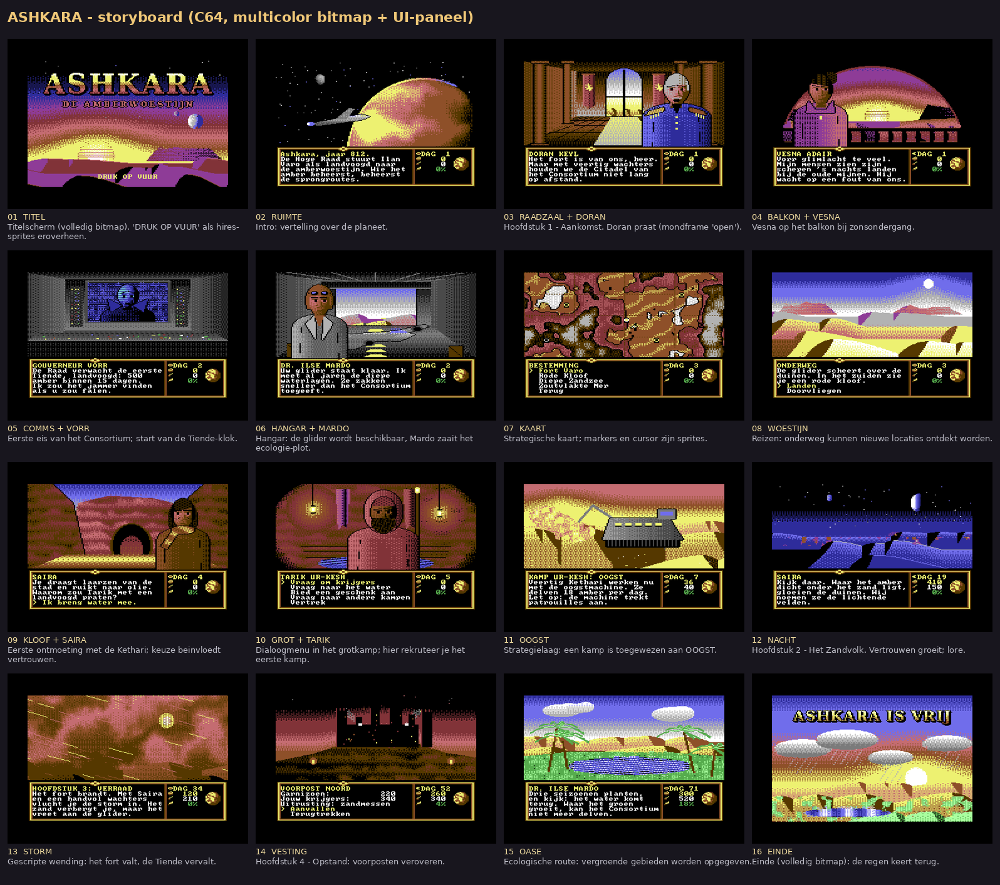

# DUNE64 — ontwerpdocument voor *ASHKARA: De Amberwoestijn*

**Platform:** Commodore 64 (PAL), 1541-diskette (D64) · **Taal/toolchain:** C + 6502-assembly met **cc65 2.19**, testen in **VICE 3.7** (`x64sc`) · **Doelgroep van dit document:** de AI-developer die het spel bouwt.

> **Status:** alle fasen (0 t/m **5: muziek, fastloader, voorbereiding op echte hardware**) zijn klaar. Alle schermen bestaan als C64-data in `assets/`; `demo/ashkara-demo.d64` is de schermen-demo. Het spel staat in `src/`, `script/` en `data/`: hoofdstuk 1 is van begin tot eind speelbaar (`python build.py play`): Fort Varo, kaart met markers, reizen, ontdekken onderweg, Saira en Tarik, werven, OOGST, rusten, de eerste Tiende betalen, en game over bij een gemiste Tiende. Fase 3 voegt overvallen van het Consortium toe (vanaf hoofdstuk 2) en opslaan/laden. Daarna kwamen erbij: de **vluchtanimatie** (§4.9) en **tweetaligheid NL/EN** (§9.4). Fase 4 maakt het spel compleet: H2 (verklikker, water, lichtende velden), H3 *Verraad* op dag 34, H4/H5 met gevechten, de handelaars van Mer, windvangers, en een militair en een groen einde. Fase 5 voegt toe: eigen SID-muziek, een eigen fastloader (scènes < 3 s), een gecomprimeerd hoofdprogramma, "DRUK OP VUUR"-sprites op het titelscherm en een diagnose-diskette voor echte hardware. Alles is getest in VICE met **true drive emulation**; een test op een echte C64 staat nog open (§16 D). Bouw hierop verder; begin niet opnieuw.

---

## Inhoud

1. [Referentie: Dune (Cryo, 1992)](#1-referentie-dune-cryo-1992)
2. [Spelconcept en wereld](#2-spelconcept-en-wereld)
3. [Verhaal en schermvolgorde](#3-verhaal-en-schermvolgorde)
4. [Speelsystemen](#4-speelsystemen)
5. [Scherm, UI en besturing](#5-scherm-ui-en-besturing)
6. [VIC-II-opzet en raster-split](#6-vic-ii-opzet-en-raster-split)
7. [Geheugenkaart](#7-geheugenkaart)
8. [Bestandsformaten](#8-bestandsformaten)
9. [Script-systeem (verhaal-VM)](#9-script-systeem-verhaal-vm)
10. [Code-architectuur](#10-code-architectuur)
11. [Disk-indeling en laden](#11-disk-indeling-en-laden)
12. [Build, tooling en testen](#12-build-tooling-en-testen)
13. [Kunstrichtlijnen en asset-pijplijn](#13-kunstrichtlijnen-en-asset-pijplijn)
14. [Fasering en acceptatiecriteria](#14-fasering-en-acceptatiecriteria)
15. [Valkuilen en risico's](#15-valkuilen-en-risicos)
16. [Bijlagen](#16-bijlagen)

---

## 1. Referentie: Dune (Cryo, 1992)

Cryo's *Dune* (DOS/Amiga 1992, Sega CD 1993) is een mix van avonturenspel en strategie, gezien door de ogen van de hoofdpersoon. Wat we van dat ontwerp overnemen:

| Element in het origineel | Hoe ASHKARA het doet |
|---|---|
| **Twee lagen:** een avonturenlaag in eerste persoon (paleis, grotten, woestijn) en een strategielaag met een kaart van de planeet. | Zelfde opzet: **scènes** (bitmap bovenin) met personages en menu's, en een **kaartscherm** voor reizen en het beheer van de kampen. |
| Personages staan groot in beeld en **praten met geanimeerde monden**. | Borstbeelden als **patch** over de scène, plus 3 mondframes (§8.3). |
| Een interfacepaneel onderin met commando's en dialoog, plus een **globe** en een indicator voor dag en tijd. | **UI-paneel** in de onderste 8 tekstrijen: tekst en menu links, status (dag, amber, krijgers, groen) rechts, met een draaiende globe-sprite. |
| Inheemse stammen werven en ze een taak geven: **oogsten, vechten** en later **vergroenen**. | De Kethari-kampen krijgen de taken **OOGST**, **STRIJD** en **GROEN** (§4.3). |
| De keizer eist regelmatig **leveringen** van de grondstof; mis je er een, dan ben je af. | De Hoge Raad eist de **Tiende** in amber, met oplopende hoeveelheden en deadlines (§4.4). |
| **Gescripte wending:** de vijand valt aan, en vanaf dan draait het om militaire verovering. | **Hoofdstuk 3, *Verraad*:** het fort valt en vanaf dan is het doel de bevrijding (§3). |
| **Alternatieve route via ecologie:** begroeide gebieden geeft de vijand op. | Gebieden die vergroend zijn, verlaat het Consortium; dat is een tweede manier om te winnen (§4.6). |
| Vijandelijke forten veroveren en uiteindelijk het hoofdpaleis aanvallen. | Voorposten veroveren en als finale **de Citadel** van het Consortium. |
| De tijd loopt **real-time** door. | **Dagen als beurten:** reizen en acties kosten dagen. Dat is beter speelbaar met een joystick en eenvoudiger te bouwen (§4.1). |

Bronnen: [Wikipedia – Dune (video game)](https://en.wikipedia.org/wiki/Dune_(video_game)) · [Hardcore Gaming 101 – Dune](https://www.hardcoregaming101.net/dune/) · [Wikipedia NL – Dune (computerspel)](https://nl.wikipedia.org/wiki/Dune_(computerspel)).

**Wereld en personages zijn eigen werk.** ASHKARA gebruikt geen namen, personages, logo's of beelden uit Dune. Alleen de *structuur* van het spel dient als voorbeeld. Daardoor kun je het spel later gewoon delen of uitbrengen.

---

## 2. Spelconcept en wereld

### 2.1 Pitch
Je speelt **Ilan Varo**, de nieuwe *landvoogd* van **Ashkara**, een woestijnplaneet. Onder het zand ligt **amberiet** ("amber"): gloeiende kristallen die de sprongaandrijvingen van de Ring van Werelden voeden. Het **Mijnconsortium** van gouverneur **Kasimir Vorr** beheerste de winning jarenlang en blijft als "adviseur" vanuit de noordelijke **Citadel** de dienst uitmaken. Het nomadenvolk van de **Kethari**, verdreven door de mijnbouw, wantrouwt iedereen uit de stad. Wint Ilan hun vertrouwen, dan kan hij de Tiende betalen. Na het verraad bevrijdt hij de planeet, met de wapens of door het water terug te brengen.

### 2.2 Begrippen (gebruik deze namen consequent in code en tekst)

| Begrip | Betekenis |
|---|---|
| **Ashkara** | De planeet en de speltitel. |
| **amber** (amberiet) | Grondstof en betaalmiddel. In de bodem raakt de voorraad per gebied op. |
| **de Tiende** | Periodieke amberlevering aan de Hoge Raad (zoals de leveringen aan de keizer in het origineel). |
| **Fort Varo** | Thuisbasis in hoofdstuk 1–2, met raadzaal, balkon, communicatiekamer en hangar. |
| **het Consortium** | De tegenstander: voorposten en de Citadel. |
| **Kethari** | Nomaden die in grotkampen wonen; zij zijn je troepen. |
| **kamp** | Een Kethari-nederzetting op de kaart, die je kunt werven. |
| **glider** | Je vliegtuig voor reizen over de kaart. |
| **lichtende velden** | Plekken waar het amber dicht onder het zand ligt en 's nachts gloeit; ze zijn rijk aan amber. |
| **windvanger** | Bouwwerk dat vocht opvangt; nodig voordat een kamp kan vergroenen. |

### 2.3 Personages

| Code | Naam | Rol | Thuisscène | Patch | Functie in het spel |
|---|---|---|---|---|---|
| `DORAN` | Maarschalk Doran Keyl | Wapenmeester | `RAADZAAL` | `doran.pat` | Traint STRIJD-kampen (skill +), militair advies, raakt gewond in H3, terug in H4. |
| `VESNA` | Vesna Adair | Raadsvrouw / spionnenmeester | `BALKON` | `vesna.pat` | Informatie over het Consortium, waarschuwt voor overvallen, beheert de Tiende. |
| `VORR` | Gouverneur Kasimir Vorr | Tegenstander | `COMMS` (hologram) | `vorr.pat` | Eisen, dreigementen, onderhandelen over de Tiende. |
| `MARDO` | Dr. Ilse Mardo | Planetoloog | `HANGAR` | `mardo.pat` | Ontgrendelt GROEN en windvangers, prospecteert amberrijkdom. |
| `SAIRA` | Saïra (op scherm: SAIRA) | Kethari-verkenner | `KLOOF` | `saira.pat` | Gezel: reist mee en vergroot de kans om kampen te ontdekken (§4.2). |
| `TARIK` | Tarik Ur-Kesh | Kethari-leider | `GROT` | `tarik.pat` | Geeft toestemming om te werven, centrale basis na H3. |

De hoofdpersoon is nooit in beeld: alles is eerste persoon, net als in het origineel.



---

## 3. Verhaal en schermvolgorde

### 3.1 Hoofdstukken

| # | Titel | Dagen (richtlijn) | Doel van de speler | Belangrijkste gebeurtenissen |
|---|---|---|---|---|
| H1 | **Aankomst** | 1–15 | Kennismaken, eerste Tiende (500 amber vóór dag 15). | Intro → raadzaal (Doran) → balkon (Vesna) → comms (eerste eis van Vorr) → hangar (Mardo, glider) → kaart → eerste vlucht → Rode Kloof (Saira) → grotkamp (Tarik): eerste kamp geworven en aan OOGST gezet → Tiende verschepen. |
| H2 | **Het Zandvolk** | 15–33 | Meer kampen ontdekken en werven; tweede Tiende (900 vóór dag 30). | Nachtscène met Saira (lichtende velden, lore), Mardo over de dalende waterlagen, Vesna ontmaskert een verklikker, het Consortium begint kampen te overvallen. |
| H3 | **Verraad** | ±34 (script) | Overleven. | Nachtelijke aanval op Fort Varo, Doran gewond, vlucht door de zandstorm naar het grotkamp. Vanaf nu **geen Tiende meer** en is de basis het grotkamp. |
| H4 | **Opstand** | 34–90 | Voorposten veroveren en/of gebieden vergroenen. | Doran terug: STRIJD-kampen trainen. Mardo: windvangers en GROEN. Handelaars van Mer verkopen uitrusting. Ondervraagde officieren verraden de Citadel. |
| H5 | **De Citadel** | — | Eindaanval op de Citadel, óf genoeg groen zodat het Consortium vertrekt. | Gevecht → `EINDE` (militaire of groene eindtekst). |

**Game over:** Tiende gemist (H1–H2, "De Raad trekt je aanstelling in"), Ilan sneuvelt in een gevecht waar hij aan meedeed, of alle kampen zijn bezet.

### 3.2 Storyboard: schermen in verhaalvolgorde

Elke regel is een echt C64-scherm; zie `mockups/NN_*.png`. De demo-diskette loopt precies deze volgorde door.

| Stap | Scherm | Personage | Hoofdstuk / doel | Mockup |
|---|---|---|---|---|
| 01 | `TITEL` (25 rijen) | — | Titel; "DRUK OP VUUR" als hires-sprites. | `mockups/01_TITEL.png` |
| 02 | `RUIMTE` | — | Intro: vertelling. | `mockups/02_RUIMTE.png` |
| 03 | `RAADZAAL` | Doran | H1: welkom, situatie. | `mockups/03_RAADZAAL_DORAN.png` |
| 04 | `BALKON` | Vesna | H1: waarschuwing over Vorr. | `mockups/04_BALKON_VESNA.png` |
| 05 | `COMMS` | Vorr | H1: eerste eis, Tiende-klok start. | `mockups/05_COMMS_VORR.png` |
| 06 | `HANGAR` | Mardo | H1: glider beschikbaar, waterlagen. | `mockups/06_HANGAR_MARDO.png` |
| 07 | `KAART` | — | Reizen en strategie. | `mockups/07_KAART.png` |
| 08 | `WOESTIJN` | — | Onderweg: ontdekking ("Landen/Doorvliegen"). | `mockups/08_WOESTIJN.png` |
| 09 | `KLOOF` | Saira | H1: eerste contact; keuze telt mee voor vertrouwen. | `mockups/09_KLOOF_SAIRA.png` |
| 10 | `GROT` | Tarik | H1: werven (dialoogmenu). | `mockups/10_GROT_TARIK.png` |
| 11 | `OOGST` | — | Strategie: een kamp op OOGST. | `mockups/11_OOGST.png` |
| 12 | `NACHT` | (Saira, alleen tekst) | H2: lichtende velden. | `mockups/12_NACHT.png` |
| 13 | `STORM` | — | H3: vlucht. | `mockups/13_STORM.png` |
| 14 | `VESTING` | — | H4: aanval op een voorpost. | `mockups/14_VESTING.png` |
| 15 | `OASE` | (Mardo, alleen tekst) | H4: vergroening werkt. | `mockups/15_OASE.png` |
| 16 | `EINDE` (25 rijen) | — | Overwinning. | `mockups/16_EINDE.png` |

### 3.3 Locaties en scènegebruik

| Locatie (op de kaart) | Scène(s) | Menu (voorbeeld) |
|---|---|---|
| Fort Varo | `RAADZAAL`, `BALKON`, `COMMS`, `HANGAR` | Praat met … / Naar balkon / Naar comms / Naar hangar / Kaart |
| Rode Kloof (kamp 1) | `KLOOF` → `GROT` | Binnengaan / Praat met Saira / Vertrek |
| Overige kampen | `KLOOF` of `GROT` (later: varianten met een andere kleur of personages) | Werven / Taak geven / Status / Vertrek |
| Diepe zandzee, oogstvelden | `WOESTIJN`, `OOGST`, `NACHT` | Oogstmachine plaatsen / Verder |
| Voorposten van het Consortium | `VESTING` | Aanvallen / Verkennen / Terugtrekken |
| Zoutvlakte van Mer (handelaars) | `WOESTIJN` (later een eigen scène) | Kopen / Verkopen / Vertrek |
| Vergroende kampen | `OASE` | Status / Vertrek |
| De Citadel | `VESTING` (variant) | Eindaanval |

Nieuwe scènes (variant-grot, handelspost, Citadel-interieur) staan in de backlog (§14) en volgen dezelfde pijplijn (§13).

---

## 4. Speelsystemen

### 4.1 Tijd
- De klok telt in **dagen** (`day`, 16-bit) plus `night` (0/1), afgeleid van de dagfase.
- **Dag-tick:** elke reis over de kaart kost `ceil(afstand / 10)` dagen (afstand in kaartcellen, Manhattan). Rusten in een kamp kost 1 dag. Gesprekken en menu's kosten niets.
- Per verstreken dag draait `sim_day()` (§4.7) één keer.
- **Nacht** valt in de tweede helft van een reis (cosmetisch: maan-icoon in het paneel, `NACHT` als reisscène). Sommige script-events eisen nacht.

### 4.2 Kaart, reizen en ontdekken
- `KAART` is een bitmap van 40×17 cellen. Elke **locatie** heeft een cel `(x, y)`.
- **Markers:** de engine overschrijft een hele cel met een markerglyph: bitmap = ruitje (`pipeline/mockups.py:MARKER`), kleur-RAM = markerkleur, scherm-RAM hoog = binnenkleur. Bewaar de originele 10 bytes van de cel (8 bitmap + 1 scherm + 1 kleur) om terug te zetten. Kleuren: Fort = wit met geel hart, bondgenoot = geel, bekend kamp = lichtgrijs, Consortium = rood. De geselecteerde bestemming **knippert** (kleur-RAM wisselt elke 16 frames tussen markerkleur en zwart).
- **Bestemming kiezen** gaat via het paneelmenu "BESTEMMING" met alleen bekende locaties (max. 5 per pagina, links/rechts bladert). Er is geen vrije cursor.
- **Ontdekken:** bij elke reis loopt de engine onbekende kampen af binnen 4 cellen van de rechte lijn tussen vertrek en bestemming. Kans per kamp: 25 %, plus 25 % als Saira meereist, plus 15 % als het een lichtend veld is. Bij een treffer verschijnt het tussenscherm `WOESTIJN` ("ONDERWEG … Landen / Doorvliegen"). Landen zet de status op BEKEND en opent de kampscène.
- Er zijn **12 kampen**, **4 voorposten**, **1 Citadel**, **1 handelspost** en **Fort Varo**. Hun posities staan in de data, niet in de code (`data/locations.json` → binair, §8.6).

### 4.3 Kampen (Kethari)

```c
typedef struct {
    unsigned char name;      /* string-id                                   */
    unsigned char x, y;      /* kaartcel                                    */
    unsigned char status;    /* ONBEKEND, BEKEND, BONDGENOOT, BEZET, GROEN  */
    unsigned char size;      /* aantal Kethari (10..90)                     */
    unsigned char trust;     /* 0..100 (werven kan vanaf 50)               */
    unsigned char job;       /* GEEN, OOGST, STRIJD, GROEN                  */
    unsigned char skill;     /* 0..100 (gevechtservaring)                   */
    unsigned char equip;     /* 0..3 uitrustingsniveau                      */
    unsigned char richness;  /* resterend amber in de bodem (0..255)        */
    unsigned char green;     /* 0..100 vergroening van het gebied           */
    unsigned char flags;     /* F_HARVESTER, F_WINDVANGER, F_SAIRA_HIER ... */
} camp_t;                    /* 12 bytes; 16 slots = 192 bytes              */
```

- **Werven:** `trust >= 50` én Tarik heeft het goed gevonden (vlag `f_tarik_zegen`). Vertrouwen stijgt met dialoogkeuzes (+5 tot +20, opcode `TRUST`), geschenken (water/amber) en een bevrijd kamp (+30). Het daalt als je een kamp laat overvallen (−20). Fase 2: `@GESCHENK` +15 en `@PRAAT` +5, elk één keer per kamp (vlaggen `LF_GESCHENK`/`LF_GESPROKEN`); bij andere kampen dan Ur-Kesh telt Tariks zegen als +20.
- **Taken** (in het menu van het kamp, of op afstand nadat `f_verbinding` is vrijgespeeld in H4):
  - **OOGST:** `amber/dag = size × min(richness, 100) / 200 × (1 + harvester)`. Voorbeeld: 40 man, richness 100, met machine → 40/dag. `richness` daalt met de dagopbrengst / 4. (Fase 2: deler 220 → 200 en het voorbeeld rechtgezet; met één kamp haal je 500 amber vóór dag 16 niet, met twee wel.) De eerste oogstmachine krijg je van Mardo (vlag `oogstmachine`); hij gaat naar het eerste kamp dat je op OOGST zet.
  - **STRIJD:** `skill += 2/dag` (+4 als Doran in het kamp is), maximaal 100. Een kamp met STRIJD beschermt kampen binnen 6 cellen tegen overvallen.
  - **GROEN:** alleen met `F_WINDVANGER` (kost 150 amber, na Mardo's ontgrendeling in H4). Dan `green += 1/dag`, en de `richness` van het gebied → 0 zodra `green >= 60`.

### 4.4 Amber en de Tiende
- `amber` (16-bit) is de voorraad in het fort en tevens het betaalmiddel.
- **Tiende-schema** (H1–H2): 500 vóór dag 15, 900 vóór dag 30. Verschepen gebeurt handmatig in `COMMS` via "Tiende verschepen". Dat schrijft af, zet `tiende_n++` en toont Vorr's reactie. Mis je een deadline, dan volgt een waarschuwing en 3 dagen uitstel; daarna game over.
- Vanaf H3 (`f_verraad`) is er geen Tiende meer, en gaat amber naar **uitrusting** bij de handelaars van Mer:

| Niveau | Naam | Prijs per kamp | Gevechtsfactor |
|---|---|---|---|
| 0 | Blote handen/messen | — | ×1.0 |
| 1 | Zandmessen & lansen | 80 | ×1.4 |
| 2 | Schokgeweren | 200 | ×2.0 |
| 3 | Zware wapens | 300 (fase 4: was 450) | ×3.0 |
| — | Oogstmachine (OOGST ×2) | 120 | — |
| — | Windvanger (GROEN mogelijk) | 150 | — |

### 4.5 Gevechten (abstract)
```
kracht   = Σ (size × (1 + skill/50) × factor[equip])   over deelnemende kampen (max 3)
kracht  *= (Ilan_mee ? 1.2 : 1.0)
kans_win = kracht / (kracht + garnizoen)        → rnd(0..255) < kans_win × 256
```
- **Winst:** de voorpost wordt een kamp (BONDGENOOT, vertrouwen 80), gevangenen komen vrij, en de ondervraagde officier geeft een hint (scriptvlag).
- **Verlies:** de deelnemende kampen verliezen 50 % `size`. Was Ilan mee, dan is het game over.
- **Overvallen door het Consortium** (`sim_day`): per OOGST-kamp zonder STRIJD-bescherming binnen 6 cellen is de kans per dag `2 % + 1 % per 20 amber/dag`. Dan wordt het kamp BEZET, vervalt de taak en daalt het vertrouwen met 20, tot je het bevrijdt (fase 4: `@GEVECHT`). **Fase 3:** overvallen beginnen pas na de eerste Tiende (vlag `f_overvallen`, gezet aan het einde van H1). Het overvallen kamp staat in `overval_loc`; de engine-node `overval` meldt het (`{plaats_overval_loc}`). Is er daarna geen enkele bondgenoot meer en minstens één kamp bezet, dan volgt **een dag later** `gameover_bezet`, zodat de speler eerst het bericht ziet. Bezette kampen tonen de node `kamp_bezet` (ook de Rode Kloof). Khimar en Varrak zijn verschoven, zodat Ur-Kesh en Kaim een buurkamp binnen 6 cellen hebben.
- Garnizoenen: voorposten 120/180/220/300, Citadel **480** (fase 4: was 600), een bezet kamp 60.

**Fase 4, zoals gebouwd (`battle.c`):** `@GEVECHT` op een voorpost, de Citadel, een bezet kamp of het bezette fort. Je kiest tot 3 bondgenootkampen (vuur = aan/uit) en of Ilan meegaat. De kopregel toont `KRACHT k TEGEN g p%`. Een aanval kost een dag.
- **Gewonnen:** de deelnemers verliezen 10 %. Een voorpost wordt een kamp (BONDGENOOT, size = garnizoen/8, vertrouwen 80, skill 20, uitrusting 1) en `veroverd` telt op. Na 2 veroverde voorposten verraden de officieren de Citadel (`f_citadel`), en pas dan kan de eindaanval. Een bezet kamp of het fort wordt bevrijd (+30 vertrouwen). Valt de Citadel, dan volgt `einde_militair`.
- **Verloren:** de deelnemers verliezen 50 %. Was Ilan mee, dan volgt `gameover_gesneuveld`.
- Uitslagen zijn script-nodes (via `sim_pending`); `{plaats_gevecht_loc}` noemt de plek.
- **Groei:** na het verraad krijgt elk bondgenootkamp elke 5 dagen 1 krijger erbij (max. 90). Zonder groei blijven kampen na een paar gevechten te klein voor de Citadel (zie §4.10).

### 4.6 Vergroening (tweede manier om te winnen)
- `groen%` in het paneel is het gemiddelde van `green` over alle gebieden met een kamp of voorpost.
- **Fase 4, zoals gebouwd:** de windvanger wordt ontgrendeld op dag 44 (Mardo), kost 150 amber bij Mer en maakt de taak *Vergroenen* mogelijk. Die geeft **+2 groen per dag** (was +1; anders haal je het niet binnen de H4-periode). Bij een voorpost telt het gemiddelde groen van de kampen binnen **8 cellen** (was 6: anders hebben Mijn Noord en de Zoutmijn geen enkel kamp in de buurt), en **bezette kampen tellen niet mee**. Een opgegeven voorpost wordt een kamp met groen 60. Is groen% ≥ 50 en er is geen voorpost meer, dan volgt `einde_groen`. Een groen kamp (≥ 60) toont de scène `OASE` en een groene marker.
- Een voorpost met een gemiddelde `green >= 60` in een straal van 6 cellen wordt **opgegeven** (status → kamp BONDGENOOT), zonder gevecht.
- **Winst** met `groen% >= 50` en alle voorposten weg: de Citadel geeft zich over en je krijgt de groene eindtekst. **Militaire winst** door de Citadel te veroveren geeft de militaire eindtekst. Beide eindigen in `EINDE`.

### 4.7 `sim_day()`: volgorde per dag
1. Per kamp: de taak uitvoeren (§4.3).
2. Overvallen van het Consortium (§4.5).
3. Voorposten laten vallen door vergroening (§4.6).
4. Deadline van de Tiende controleren (§4.4).
5. Tijd-events uit het script afvuren (`ON_DAY n` → node, §9).
6. `day++`; nacht/dag wisselen; het paneel bijwerken.

### 4.10 Balans (fase 4): `pipeline/balance.py`
Een Python-port van `sim_day()` en de gevechten, met een gesimuleerde speler.
- **Militair:** die speler wervt vóór het verraad kampen (de meeste oogsten, elke derde traint), zet daarna de 4 sterkste op STRIJD, koopt wapens en valt aan bij ≥ 65 % kans: eerst de zwakste voorpost, en de Citadel zodra dat kan.
- **Groen:** koopt windvangers en laat kampen vergroenen.

Uitslag over 300 seeds (`python pipeline/balance.py 300`):

| Strategie | Gewonnen | Dag (mediaan) | Verloren |
|---|---|---|---|
| Militair | 275/300 | 59 | 0 |
| Groen | 221/300 | 88 | 0 |

De rest haalt het niet binnen 150 dagen; een echte speler kan beide routes mengen (een voorpost veroveren op de groene route). Daarvoor aangepast: zware wapens 300, Citadel 480, groei na het verraad, groen +2/dag, de straal voor het opgeven 8, bezette kampen tellen niet mee.

### 4.9 Vluchtanimatie (`flight.c`, `pipeline/flight.py`)
In Cryo's *Dune* is het vliegen met de ornithopter een kenmerkend onderdeel: je kijkt uit de cockpit en de woestijn raast onder je door (de cd-versie verving dat door vooraf gerenderde 3D). ASHKARA doet dat op de C64 met **kleurcycli**: de scène `vlucht.scn` (17 rijen) toont een cockpitraam (zwarte stijlen en een dashboard met wijzers), lucht met tafelbergen en grond die tot aan de horizon in **duinbanden** in perspectief is verdeeld. Elke grondpixel heeft slot `1 + (band mod 3)`. De engine geeft per tekenrij drie kleuren (scherm-RAM hoog/laag, kleur-RAM) en draait die elke 4 frames één plaats door, waardoor de banden naar je toe schuiven. Per stap is dat 10 rijen × 80 bytes `memset`, het bitmap blijft ongemoeid. De golven in de banden (sinus over wereld-x) maken er duinen van; vlak bij de horizon is de rij één kleur (nevel) om moiré te verbergen. Paletten per rij voor dag en nacht staan in `src/flight_tab.h` (gegenereerd). Een reis toont 75 frames per reisdag in de tweede helft van de reis met het nachtpalet; vuur slaat de rest van de animatie over. Bij een ontdekking onderweg vlieg je eerst de helft van de reis, dan verschijnt `WOESTIJN`.

### 4.8 Startwaarden en balans (eerste versie; tunen in fase 4)

| Variabele | Start |
|---|---|
| `day` | 1 |
| `amber` | 0 |
| wachters (geen kamp) | 40 (telt alleen in de H3-scriptscène) |
| kamp 1 (Ur-Kesh) | size 40, trust 30, richness 120 |
| overige kampen | size 15–90, trust 10–40, richness 40–220 |
| `f_*` vlaggen | 0 |

---

## 5. Scherm, UI en besturing

### 5.1 Schermindeling

```
 rij  0 ┌──────────────────────────────────────────┐  ⎫
      │      SCÈNE: multicolor bitmap 160×136       │  ⎬ 17 tekenrijen (raster 51–186)
 rij 16 │  (onderste 2 pixelrijen altijd zwart)    │  ⎭
 rij 17 ╞══════════ kader (MC-tekens) ═════╤═══════╡  ⎫
 rij 18 │ SPREKER (geel)                 │☼DAG 12 │  ⎪
 rij 19 │ tekst / menu-optie (wit)       │◆  450 ◯│  ⎪ 8 tekenrijen tekstmodus
 rij 20 │ ...      26 kolommen           │⚔  120  │  ⎬ (raster 187–250)
 rij 21 │ ...                            │♣  18%  │  ⎪ ◯ = globe-sprite
 rij 22 │ ...                            │        │  ⎪
 rij 23 │ > geselecteerde optie (geel)   │        │  ⎪
 rij 24 ╘════════════════════════════════╧════════╛  ⎭
```

- **Tekstgebied:** kolommen 1–26, rijen 18–23 (6 regels). Regel 0 is gewoonlijk de **sprekernaam** (geel), regels 1–5 bevatten tekst. Lange teksten worden **gepagineerd** (5 regels per pagina, vuur = verder, ▼-teken rechtsonder in kolom 26 als er meer komt).
- **Statusgebied:** kolom 28 bevat het icoon (MC-teken), kolommen 29–33 de waarde. Dag (zon/maan), amber, krijgers (totaal `size` van STRIJD-kampen), groen %.
- **Globe:** multicolor-sprite 0 op schermpositie (284, 153), VIC-coördinaten X = 308 (`$D010` bit 0 = 1, `$D000` = 52), Y = 203, met 8 frames die om de 8 frames wisselen.
- **Volledige bitmapschermen** (`TITEL`, `EINDE`, 25 rijen): split uit, sprite uit.

### 5.2 Kleuren in het paneel
`$D021` = zwart, `$D022` = bruin (9), `$D023` = oranje (8). Kadertekens hebben kleur-RAM `8+7` (multicolor; `%11` = geel), wat een goudkleurig kader geeft. Tekst is hires met kleur-RAM < 8: wit (1) voor tekst, geel (7) voor sprekers en selecties, groen (5) voor groen %.

### 5.3 Charset (`assets/ui.chr`, 2 KB, geladen op `$C800`)

| Screen codes | Inhoud |
|---|---|
| 0 | `@` |
| 1–26 | a–z (kleine letters) |
| 27–31 | `[ £ ] ^ _` |
| 32–63 | spatie, `! " # $ % & ' ( ) * + , - . /`, 0–9, `: ; < = > ?` |
| 65–90 | A–Z |
| 96–114 | Kader en iconen (multicolor), zie `demo/src/ui_codes.h` (`UI_H`, `UI_TL`, `UI_SUN`, `UI_AMBER`, …) |
| 115–118 | Hires: ▼ (`UI_MORE`, meer tekst), ë, ï, é. De scriptcompiler zet ë/ï/é hier automatisch op. |
| 119–255 | vrij (reserve: extra iconen, accenten) |

De indeling volgt de screen codes van de C64-set met kleine letters. Conversie vanaf cc65-strings (PETSCII): `$40–$5F → −$40`, `$C0–$DF → −$80`, `$20–$3F` blijft gelijk (zie `ui.c: petscii_to_screen`). **De scriptcompiler (§9) schrijft direct screen codes**, zodat de engine in het echte spel niet hoeft te converteren.

Het lettertype is gebaseerd op het publiek-domein-font *font8x8* (IBM VGA, `pipeline/third_party/font8x8_basic.h`).

### 5.4 Besturing

| Invoer | Actie |
|---|---|
| Joystick poort 2 op/neer · cursor op/neer | Menu-selectie |
| Vuur · Return · Spatie | Kiezen / volgende pagina |
| Joystick links/rechts · cursor links/rechts | Bladeren door lange menu's (bestemmingen) |
| `K` | Kaart (elke locatie heeft ook een menu-optie "Kaart") |
| `F7` | Opslaan/laden-menu |
| RUN/STOP | Terug / annuleren |

Debounce: wacht na elke keuze tot alle knoppen los zijn (zie `main.c: show()`). Lees de joystick via `$DC00` en het toetsenbord via `cbm_k_getin()`. De Kernal scant het toetsenbord één keer per frame vanuit de raster-IRQ (`jmp $EA31`).

### 5.5 Praat-animatie
Patchset met 4 patches: `0` = lichaam, `1` = mond dicht, `2` = half open, `3` = open. Zolang er tekst verschijnt: elke 6 frames de volgende uit `{3,2,1,2,3,2,1,1}`. Bij het wachten op invoer: mond dicht (patch 1). Typemachine-effect (optioneel): 2 tekens per frame, met de mond-animatie zolang er tekens bijkomen.

---

## 6. VIC-II-opzet en raster-split

| Register | Waarde | Betekenis |
|---|---|---|
| `$DD00` bits 0–1 | `%00` | VIC-bank 3 (`$C000–$FFFF`). **Read-modify-write**, de andere bits zijn de seriële bus. |
| `$D016` | `$18` | Multicolor aan, 40 kolommen (geldt voor bitmap én tekst). |
| `$D018` bitmapdeel | `$08` | Scherm `$C000`, bitmap `$E000`. |
| `$D018` tekstdeel | `$02` | Scherm `$C000`, charset `$C800`. |
| `$D011` bitmapdeel | `$3B` (of `$2B` = beeld uit) | BMM=1, DEN, RSEL, YSCROLL=3. |
| `$D011` tekstdeel | `$1B` (of `$0B`) | BMM=0. |
| `$D020/$D021` | 0 / 0 | Rand en achtergrond zwart. |
| `$D022/$D023` | 9 / 8 | Multicolor voor het paneel (in bitmapmodus ongebruikt). |

Het **scherm-RAM** wordt gedeeld: rijen 0–16 bevatten de bitmapkleuren (hoge/lage nibble), rijen 17–24 de tekencodes van het paneel. Het **kleur-RAM** werkt net zo (rijen 0–16 = `%11`-kleur, rijen 17–24 = tekenkleur).

**Raster-IRQ** (`demo/src/irq.s`, getest):
- De CIA1-timer-IRQ staat uit; de VIC raster-IRQ staat aan via de vector `$0314` (Kernal-ROM blijft aan).
- **Lijn 186** zet het tekstdeel aan (`$D011`, `$D018`). Komt de IRQ een paar cycli te laat (bijvoorbeeld door een korte `SEI` in de Kernal), dan toont de eerste pixellijn van paneelrij 17 nog bitmap. Daarom: alle tekens op rij 17 hebben een lege bovenste pixelrij (ook het ornament `ORN_M`), en `gfx_load_scene` maakt bitmaprij 17 leeg, zodat daar geen resten van een volledig scherm staan. Door de overhead van de Kernal-IRQ landt de schrijfactie op het einde van lijn 186, in de rechterrand. Pixelrij 135 van elke scène is zwart, dus een eventueel glitchje is onzichtbaar. Verander de art-regel "onderste 2 pixelrijen zwart" niet.
- **Lijn 252** (onderrand) zet het bitmapdeel terug, verhoogt `frame_count` en springt naar `$EA31` (toetsenbord en jiffy-klok).
- `split_enabled = 0` voor schermen van 25 rijen. `screen_on = $00/$10` zet het beeld uit tijdens het laden (DEN).
- Muziek (fase 5, gebouwd): `music_play` (`src/music.s`) draait vanuit de IRQ op lijn 252, 1x per frame. De muziekdata ligt in de RAM onder de I/O (`$D200`); de player leest die met `$01=$34` en schrijft de SID met `$01=$35`. Tijdens uitpakken (`SEI`) staat de muziek even stil.

---

## 7. Geheugenkaart

| Bereik | Grootte | Inhoud |
|---|---|---|
| `$0002–$001B` | 26 B | cc65 zero page |
| `$00FB–$00FE` | 4 B | vrij voor eigen asm (pointers) |
| `$0801–$92FF` | ~34 KB | **Programma** (cc65 `MAIN`: code, rodata, data, bss), daarna de C-stack van **1 KB** (`$9300–$96FF`). Linkerconfig `src/ashkara.cfg` (`__HIMEM__ = $9700`). Fase 5: het spel eindigt rond `$8C93`. Op de diskette staat het **gecomprimeerd** (exomizer sfx: 31 → 16 KB). |
| `$9700–$A5FF` | 3,75 KB | `LOADBUF`: gecomprimeerd bestand van disk (grootste: `kaart.scn` 3575 B); ook kladruimte van de fastloader |
| `$A600–$B1FF` | 3 KB | `PATBUF`: uitgepakte patchset (grootste: `tarik.pat` 2687 B). **`COLBUF` deelt deze ruimte**: alleen nodig tijdens het uitpakken van een scène, en een nieuwe scène wist het personage toch |
| `$B200–$BFFF` | 3,5 KB | `SCRIPTBUF`: scriptblok van het huidige hoofdstuk (§9; de compiler bewaakt 3584 B) |

In fase 4 en 5 is de buffer-indeling twee keer compacter gemaakt (kleinere stack, `SCRIPTBUF` 3,5 KB, `COLBUF` = `PATBUF`) en zijn muziek en drivecode onder de I/O gezet. `build.py` (`check_buffers`) weigert assets die niet in hun buffer passen. Vrij: ~1,6 KB tussen programma en stack.
| `$C000–$C3E7` | 1000 B | Scherm-matrix (VIC-bank 3) |
| `$C3F8–$C3FF` | 8 B | Sprite-pointers |
| `$C400–$C7FF` | 1 KB | Spritedata, blokken 16–31 (globe 16–23; 24–27 "DRUK OP VUUR", 28–31 "PRESS FIRE", allebei in `globe.spr`) |
| `$C800–$CFFF` | 2 KB | UI-charset |
| `$D000–$DFFF` | — | I/O (CPU); kleur-RAM `$D800`. **De RAM eronder (4 KB)**: `extra.bin` bij het opstarten, met op `$D000` de lengte en de fastloader-drivecode (max. 510 B) en op `$D200` de muziekdata. Lezen/schrijven alleen met `$01=$34` (`io_copy`, `music.s`). |
| `$E000–$FF3F` | 8000 B | Bitmap (onder de Kernal-ROM; schrijven kan altijd, lezen alleen met `$01=$35`) |
| `$FFFA–$FFFF` | 6 B | RAM-vectoren → RTI-stub (nodig tijdens uitpakken met de Kernal weggebankt) |

**Gebruikt in de demo:** programma `$0801–$2654` (7 KB); de demo houdt de oude indeling (`demo/src/gfx.h`).

Spelstatus (vlaggen, variabelen, kampen) staat in BSS. Reken op ~600 B, zodat de savegame die blokken 1-op-1 kan wegschrijven (§11.3).

---

## 8. Bestandsformaten

### 8.1 Algemeen
- Elk bestand is een **PRG**: 2 bytes laadadres, dan de payload. `cbm_load(naam, drive, buffer)` laadt de payload **zonder** de 2 adresbytes naar `buffer`. `cbm_load(naam, drive, 0)` laadt naar het eigen laadadres (gebruikt voor `ui.chr` → `$C800` en `globe.spr` → `$C400`).
- Compressie gebruikt **raw deflate** (zlib `wbits=-15`). Uitpakken gaat met cc65's `inflatemem(dest, src)` uit `<zlib.h>`. Gemeten in VICE: ongeveer **1–1,5 s** per scène.
- Magic-bytes vergelijk je als getallen (`0x53`), **niet** als `'S'`: cc65 vertaalt tekenliterals naar PETSCII.

### 8.2 Scène: `.scn`
```
payload offset  grootte  inhoud
0               1        $53 'S'
1               1        rijen R (17 = scène boven het paneel, 25 = volledig scherm)
2               1        flags (bit0 = deflate)
3               1        achtergrondkleur (altijd 0)
4               2        lengte bitmap-stroom (LE)
6               2        lengte kleur-stroom (LE)
8               ...      deflate(bitmap: R×320 bytes, cel-volgorde zoals VIC)
8+len_bm        ...      deflate(scherm-RAM R×40 ‖ kleur-RAM R×40)
```
**Laadprocedure** (`gfx.c: gfx_load_scene`, getest):
1. `cbm_load → LOADBUF`.
2. `SEI`, `$01 = (oud & $F8) | $05` (Kernal uit, I/O aan), `inflatemem($E000, LOADBUF+8)`, `$01` terug, `CLI`. Inflate leest terug uit zijn eigen uitvoer, en onder `$E000` zit anders de Kernal-ROM.
3. `inflatemem(COLBUF, …)`, daarna `memcpy` naar `$C000` en `$D800`. Pak nooit direct uit in het kleur-RAM: dat is nibble-RAM.

### 8.3 Patchset: `.pat`
```
payload: $50 'P', flags, unpacked_size (LE16), deflate(raw)
raw:     n, dan n× patch
patch:   x, y, w, h (in cellen)  ‖ bitmap w×h×8 (rij voor rij, per cel 8 bytes)
                                  ‖ scherm-RAM w×h ‖ kleur-RAM w×h
```
Personages hebben altijd 4 patches (§5.5). Een patch toepassen = `memcpy` per rij (`gfx_apply_patch`). Bitmapschrijfacties onder de ROM werken met de Kernal gewoon aan. Gebruik hetzelfde formaat voor **staatswijzigingen** in scènes: brandend fort, open poort, glider weg, enzovoort.

### 8.4 `ui.chr` en `globe.spr`
- `ui.chr`: laadadres `$C800`, 2048 bytes (256 tekens × 8).
- `globe.spr`: laadadres `$C400`, 8 × 64 bytes multicolor-sprites. Kleuren: sprite = oranje (8), `$D025` = bruin (9), `$D026` = geel (7).

### 8.5 Koala (`art/koala/*.kla`)
Alleen om te bekijken en te bewerken in externe tools (laadadres `$6000`, 10001 bytes). Het spel gebruikt ze niet.

### 8.6 Spel-data: `data/locations.json` (fase 2, gebouwd)
Per locatie: id, naam (max. 14 tekens), type (`FORT`, `KAMP`, `VOORPOST`, `CITADEL`, `HANDEL`), cel `(x, y)`, startstatus, startwaarden (§4.3; voor voorposten is `size` = garnizoen / 4), vlaggen (`LICHTEND`, `HARVESTER`) en de **aankomst-node** in het script. `pipeline/datac.py` controleert de data; `scriptc.py` roept het aan (de node-pointers zijn pas na het compileren bekend) en schrijft `src/data.c` met `loc_init[]`, `loc_names[]` (screen codes) en `loc_nodes[]`. Een apart `locations.dat` op de diskette is daardoor niet nodig: de startwaarden zijn 19 × 12 bytes. `game_init()` kopieert ze naar `locs[]`. Nieuwe locaties komen onderaan (de index is het locatie-id, ook in savegames).

---

## 9. Script-systeem (verhaal-VM)

Verhaal, dialogen en menu's staan **niet in C** maar in scriptbestanden. Een compiler in Python zet ze om naar bytecode, en een kleine VM in de engine voert die uit. Zo kun je de inhoud uitbreiden zonder de engine opnieuw te compileren.

### 9.1 Bronformaat: `script/h1.ash` (voorbeeld)
```text
; Hoofdstuk 1 - Aankomst
:raadzaal
  SCENE raadzaal
  IF NOT doran_ontmoet
    CHAR doran
    SAY "DORAN KEYL"
    TEXT "Het fort is van ons, heer. Maar met veertig wachters houden we de Citadel van het Consortium niet lang op afstand."
    SET doran_ontmoet
  END
  MENU
    OPT "Praat met Doran"       doran_praat   IF doran_ontmoet
    OPT "Naar het balkon"        balkon
    OPT "Communicatiekamer"      comms
    OPT "Hangar"                 hangar        IF vorr_eis
    OPT "Kaart"                  @KAART        IF glider
  END

:comms
  SCENE comms
  CHAR vorr
  IF NOT vorr_eis
    SAY "GOUVERNEUR VORR"
    TEXT "De Raad verwacht de eerste Tiende, landvoogd: 500 amber binnen 15 dagen. Ik zou het jammer vinden als u zou falen."
    SET vorr_eis
    TIENDE 500 15
  END
  MENU
    OPT "Tiende verschepen"      @TIENDE       IF amber >= tiende_eis
    OPT "Terug naar de raadzaal" raadzaal
  END

ON_DAY 34 verraad          ; tijd-event: springt naar node 'verraad' (in h3.ash)
```

### 9.2 Bytecode (één byte opcode + operanden)

| Opcode | Naam | Operanden | Werking |
|---|---|---|---|
| `$01` | SCENE | scène-id (1) | Scène laden (zelfde scène = niets doen), paneel tekenen. |
| `$02` | CHAR | personage-id (1) | Patchset laden + patch 0/1. `$00` = geen personage. |
| `$03` | SAY | string-ptr (2) | Sprekernaam in regel 0. |
| `$04` | TEXT | string-ptr (2) | Gepagineerde tekst met praat-animatie; wacht op vuur per pagina. |
| `$05` | MENU | n (1), dan n × [cond (2+), string-ptr (2), doel (2)] | Toont opties waarvan de cond waar is, geeft de keuze, springt. |
| `$06` | JUMP | node-ptr (2) | |
| `$07` | IF | cond, skip-offset (2) | Springt `skip` verder als de cond onwaar is. |
| `$08` | SET / `$09` CLR | vlag (1) | 256 vlaggen (32 bytes). |
| `$0A` | ADD | var (1), waarde (2, signed) | 32 variabelen van 16 bit (amber, dag, tiende_eis, …). |
| `$0B` | CALL | builtin-id (1) | `@KAART`, `@TIENDE`, `@WERVEN`, `@TAAK`, `@GEVECHT`, `@HANDEL`, `@OPSLAAN`, `@EINDE`. |
| `$0C` | WAIT | frames (1) | |
| `$0D` | TIENDE | bedrag (2), dagen (1) | Zet de eis en de deadline. |
| `$0E` | ONDAY | dag (2), script-id (1), node-ptr (2) | Registreert een tijd-event (max. 8 actief). Het doel mag in een ander blok liggen. |
| `$0F` | LOAD | script-id (1), node-ptr (2) | Ander scriptblok laden (hoofdstukwissel) en springen. |
| `$10` | MUSIC | tune-id (1) | Fase 5. |
| `$11` | SKIP | offset (2) | Relatieve sprong vooruit (de compiler gebruikt hem voor `ELSE`). `JUMP` is alleen voor nodes, want die zet de huidige node. |
| `$FF` | END | — | Terug naar de node van het laatst getoonde menu (de "thuis-node"). De compiler zet een `END` achter elke node die niet eindigt op `MENU`, `JUMP` of `LOAD`. |

**Menu-doelen:** een doel `$FFxx` is builtin `xx` (zoals `@KAART`); na de builtin gaat de VM terug naar de menu-node. Een `JUMP` naar een node in een ander blok compileert de compiler als `LOAD`.

**Condities** (`cond`): `$00` altijd waar · `$01 v` vlag gezet · `$02 v` vlag niet gezet · `$03 var waarde16` var ≥ waarde · `$04 var waarde16` var < waarde · `$05 kamp status` kampstatus = status · `$06 var var2` var ≥ var2 · `$07 var var2` var < var2 · `$08 cond cond` beide waar (bron: `IF a AND b`).

**Blokindeling** (na uitpakken in `SCRIPTBUF`): `first_node` (2), `n_ondays` (1), dan *n* × [dag (2), script-id (1), node (2)] voor de `ON_DAY`-regels op topniveau, daarna de code en de strings.

**Strings** staan in screen codes. De compiler doet de **woordafbreking** (TEXT op 25 kolommen, zodat kolom 26 vrij blijft voor het ▼-teken; SAY 26; menu-opties 24 na "> ") en de **paginering per 5 regels**: `$FE` = nieuwe regel, `$FD` = nieuwe pagina, `$FF` = einde. Een `|` in de brontekst dwingt een nieuwe regel af. Pointers zijn relatief ten opzichte van het begin van het blok. Uitgepakt moet een blok in `SCRIPTBUF` (4 KB) passen. De compiler geeft een fout als dat niet lukt; splits dan het hoofdstuk (`h2a.ash`, `h2b.ash` met `LOAD`).

**Tekst (fase 2):** de compiler breekt TEXT niet meer zelf af; dat doet de engine (`text.c`), zodat er getallen en namen in kunnen: `{amber}` (elke variabele) → `$FC id`, `{loc}` (naam van de huidige locatie) → `$FB`. `|` = nieuwe regel (`$FE`), `||` = nieuwe pagina (`$FD`). De compiler controleert alleen dat geen woord breder is dan 25 kolommen. Ook SAY mag escapes bevatten.

**Fase 2-uitbreidingen:** opcode `$12 TRUST delta` (vertrouwen van het kamp op de huidige locatie); condities `$09 var waarde16` (=), `$0A cond` (NIET, bron `NOT <cond>`), `$0B n` (bron `VERTROUWEN >= n`), en bij `$05` locatie `$FF` = hier (bron `KAMP HIER = BONDGENOOT` of `KAMP <locatie-id> = …`). Builtins erbij: `@STATUS`, `@RUST`, `@GESCHENK`, `@PRAAT`, `@GAMEOVER`. `ids.txt` kent ook `node <naam>`: nodes die de engine zelf aanroept (`tiende_waarschuwing`, `gameover_tiende`). Een hoofdstuk mag over meerdere blokken verdeeld zijn: H1 is `h1` (fort) + `h1w` (woestijn).

**Tijd-events (fase 3):** `ON_DAY`-regels op topniveau gaan via `init_events[]` in `src/data.c`; `game_init()` zet ze klaar. De tabel in de blokkop wordt niet meer gebruikt, anders kwam een afgevuurd event terug zodra het blok opnieuw laadde. Escape `$FA var` (bron `{plaats_<var>}`) toont de naam van de locatie met index `var`. Builtin `@LADEN` is erbij.

**Na een builtin** gaat de VM eerst naar een node die de simulatie klaarzette (`sim_pending`: Tiende-waarschuwing, game over, `ON_DAY`), dan naar een node die de builtin vroeg (`vm_next`: aankomst na een reis), anders opnieuw naar de menu-node. Een `END` in een event-node gaat naar de aankomst-node van de huidige locatie.

**Overige bronsyntax:** `IF … ELSE … END`, `RETURN` (expliciete `END`), `CALL @NAAM`, `CHAR none`, `ADD var n`, `WAIT frames`, `TIENDE bedrag dagen`, `ON_DAY dag node` (binnen een node → opcode, op topniveau → bloktabel), `LOAD script node`. `TIENDE` zet ook de vlag `tiende_open`; `@TIENDE` schrijft het amber af en wist die vlag.

### 9.4 Twee talen (Nederlands / Engels)
- **Scripts:** één bron per blok, met het Engels erbij: `SAY "nl" "en"`, `OPT "nl" "en" doel`, en onder een `TEXT` een regel `EN "en"`. De compiler maakt per blok twee bestanden met **identieke code** (en dus identieke node-offsets) en alleen andere strings: `h1.scr` / `h1e.scr`. Ontbreekt het Engels, dan staat er Nederlands; de compiler telt die strings (alleen tekst met kleine letters, namen tellen niet). Beide varianten moeten binnen 4 KB passen.
- **Engine:** `lang` (`LANG_NL`/`LANG_EN`, geen spelstatus, niet in de savegame); `L("nl", "en")` kiest een C-string; tabellen met menu-opties zijn `[NLANGS][n]`. `script_files[NLANGS][NSCRIPTS]` en `loc_names[NLANGS][NLOCS]` (veld `name_en` in `locations.json`). "DAG"/"DAY" in het paneel.
- **Kiezen:** na het titelscherm een taalmenu (`main.c`); in het spel via F7 → "Language: English" / "Taal: Nederlands". `vm_set_lang()` laadt het huidige blok opnieuw in de andere taal en voert de menu-node opnieuw uit; dat kan omdat de offsets gelijk zijn.
- Het titelbeeld zelf ("DE AMBERWOESTIJN") is nog alleen Nederlands.

### 9.3 Compiler: `pipeline/scriptc.py` (fase 1, gebouwd)
- Invoer: `script/<naam>.ash` voor elk `script` in `script/ids.txt` (scène-, personage-, script-, vlag- en variabelenamen → id's, op volgorde; nieuwe namen altijd onderaan hun soort, want id's komen in savegames).
- Uitvoer: `assets/h1.scr` … (PRG, laadadres `$B000`, container zoals `.pat`: `'T'`, flags, size, deflate) en `src/ids.h` (defines `SCENE_*`, `CHAR_*`, `VAR_*`, `FLAG_*`, `BI_*` en de bestandsnaamtabellen).
- Validatie: onbekende node, ongebruikte node, string langer dan 26 tekens zonder spatie, een scène zonder bestand in `assets/`, een blok groter dan 4 KB.
- Extra uitvoer: `build/script_graph.txt` (knopen en sprongen) voor review.

---

## 10. Code-architectuur

```
src/
  main.c        opstart, titelscherm, start de VM                    (fase 1)
  gfx.c/.h      scène/patch laden, patches toepassen, markers      (getest)
  ui.c/.h       paneel, tekst, menu met cursor en schuiven, status, globe, ui_wait_frame  (fase 1)
  irq.s         raster-split, frame_count                           (getest)
  input.c/.h    joystick + toetsenbord, flanken, herhaling, TESTMODE  (fase 1)
  vm.c/.h       script-VM (§9): opcodes, condities, menu, scène/personage  (fase 1-2)
  text.c/.h     tekstbuffer, afbreken, pagineren, typemachine + mond     (fase 2)
  builtin.c/.h  @KAART, @TIENDE, @WERVEN, @TAAK, @STATUS, @RUST, @GESCHENK, @PRAAT, @GAMEOVER  (fase 2)
  game.c/.h     spelstatus: vlaggen, vars, locaties (loc_t), tijd-events  (fase 1-2; opslaan/laden in fase 3)
  disk.c/.h     één laadfunctie disk_load(naam, adres); later fastloader hier inpluggen  (fase 1)
  sim.c/.h      sim_day(): taken, Tiende-deadline, events; overvallen/vergroening volgen  (fase 2)
  map.c/.h      kaartscherm: markers, knipperende bestemming, reisdagen, ontdekken (WOESTIJN)  (fase 2)
  battle.c/.h   @GEVECHT: kampen kiezen, kans, uitslag (fase 4)
  flight.c/.h   vluchtanimatie met kleurcycli (§4.9); flight_tab.h gegenereerd door pipeline/flight.py
  ids.h, data.c gegenereerd door scriptc.py · ui_codes.h: gegenereerd door gen_demo.py
  ashkara.cfg   linkerconfig (kopie van demo/dune64.cfg)
```
`demo/src/` blijft de bevroren schermen-demo van fase 0.

**Hoofdlus (state machine):** `ST_TITEL → ST_SCENE (VM draait) ⇄ ST_MAP ⇄ ST_TRAVEL → ST_SCENE … → ST_EINDE / ST_GAMEOVER`. De VM is "blocking per instructie": `TEXT` en `MENU` lopen intern een wacht-lus met `wait_frame()`. Daarin doen ze de animatie (mond, globe, knipperende markers) en lezen ze de invoer.

**Regels voor cc65-code:**
- Gebruik geen `printf`/`conio`: die schrijven naar `$0400`. Alle uitvoer gaat via `ui.c`.
- Gebruik geen `malloc`: alle buffers liggen vast (§7).
- Gebruik bij voorkeur `unsigned char`-lussen en `static` locals in hete paden; compileer met `-O` (later `-Oirs`).
- Hardwareregisters spreek je aan via `*(unsigned char*)0xD0xx` of via `<c64.h>` (`VIC.bordercolor`, …).
- Bestandsnamen schrijf je in **kleine letters** in C-strings (cc65 → PETSCII-hoofdletters, net als c1541).

---

## 11. Disk-indeling en laden

### 11.1 Bestanden (gemeten, fase 0)

| Bestand | Blokken | Opmerking |
|---|---|---|
| `ashkara` | 28 | Demo-programma (het spel groeit naar ~80–120). |
| `ui.chr` / `globe.spr` | 9 / 3 | |
| 16 × `.scn` | 140 | 5–15 blokken per scène (`kaart.scn` is de grootste). |
| 6 × `.pat` | 25 | |
| **Totaal fase 0** | **205 van 664** (459 vrij) | Ruim genoeg voor scripts (5 × ~10), extra scènes (~20 × 8), muziek (~16) en een savegame. |

Eén D64-diskette volstaat. Op echte hardware (een 1541, of een C64 Ultimate met de D64 gemount) werkt alles via de Kernal.

### 11.2b Fastloader (fase 5, gebouwd)
Een eigen 2-bit-loader: `src/drive/drive.s` draait op `$0500` in de 1541 (M-W in stukken van 32 bytes, gestart met M-E), `src/fastload.s` is de C64-kant, `disk.c` kiest automatisch.
- **Protocol:** de C64 is de klok. Elke ATN-wisseling is één paar van 2 bits (DATA = bit 0, CLK = bit 1, laag = 1). Van drive naar C64 gaat ATN binnen een byte altijd aan/uit/aan/uit. De drive wacht dus met een lus van 7 cycli op precies die flank en schrijft een vooraf berekende waarde (tabel per nibble): antwoord binnen 13 cycli. De C64 leest ≥ 20 cycli na de wisseling en verwerkt in die wachttijd het vorige paar. Een badline of IRQ op de C64 maakt de wachttijd alleen langer, dus het werkt met beeld, sprites en raster-IRQ aan, op PAL en NTSC. Commando's (C64 → drive: laden + naam, stoppen, ping) gaan via een langzamere, even robuuste weg.
- **Bezig/klaar:** de drive houdt CLK laag zolang hij een sector leest (via de jobqueue van DOS, buffer 0) of de directory doorzoekt. Na elk blok bevestigt de C64 met 2 ATN-wisselingen, zodat ATN tussen transacties altijd los is. VIA1-interrupts staan uit zolang de drivecode draait.
- **Installatie:** bij het opstarten, na `extra.bin`. Antwoordt de drive niet op de ping (SD2IEC, VICE virtual device, 1581), dan blijft alles via de Kernal lopen. Voor opslaan geeft de C64 de drive terug aan DOS (`fl_command(2)`), slaat op via de Kernal en installeert daarna opnieuw.
- **Interleave 12:** de fastloader heeft ~100 ms per sector nodig (overdracht ~40 ms + job-wachttijd). Bij de standaard interleave 10 komt de volgende sector op de sporen 1–17 na 95 ms langs, net te vroeg: dan kost elke sector een extra omwenteling. `build.py` schrijft de spel-diskette daarom zelf (`pipeline/mkd64.py`) met interleave 12.
- **Gemeten** (VICE 3.9, true drive emulation, 1541-II, `tests/fltest.c`):

| Bestand | Kernal | Fastloader |
|---|---|---|
| `kaart.scn` (3575 B, de grootste) | 6,3 s | **2,7 s** |
| `titel.scn` (2889 B) | 5,1 s | 2,3 s |
| `h1.scr` (1832 B) | 3,1 s | 1,4 s |
| `ui.chr` (2048 B) | 3,8 s | 1,3 s |

- **Beperkingen:** het protocol gebruikt ATN, dus alleen drive 8 mag aan staan op de seriële bus (een printer of tweede drive reageert op ATN). Het hoofdprogramma zelf laadt nog via de Kernal (~16 KB gecomprimeerd); met JiffyDOS, een Action Replay of een Ultimate gaat dat sneller. Een eigen bootloader die ook het hoofdprogramma snel laadt, is een mogelijke vervolgstap.
- **Diagnose:** `python build.py fltest` maakt `build/fltest.d64`. Die laadt een paar bestanden via de Kernal en via de fastloader en toont lengte, checksum en laadtijd. Draai dat als eerste op echte hardware.

### 11.2 Laadsnelheid
- Met de standaard-Kernal en een echte 1541 haal je ongeveer 300–400 B/s. Een scène van 2 KB kost dan **5–7 s**, plus ~1 s uitpakken. Speelbaar, maar traag.
- **Ontwerpkeuze:** alle disk-I/O gaat via `disk_load()` in `disk.c`. In fase 5 kun je daar een IRQ-loader of fastloader (bijvoorbeeld Krill's loader of Spindle) inpluggen zonder de rest te raken. Tot die tijd werkt alles met JiffyDOS, een fastload-cartridge of de turbo-opties van een Ultimate.
- In VICE tijdens het ontwikkelen: zet *True drive emulation* uit (`+drive8truedrive -virtualdev8`) voor laden zonder wachttijd.

### 11.3 Opslaan (fase 3, gebouwd)
De hele spelstatus staat in één blok `state_t state` (`game.h`): magic `$A5`, `SAVE_VERSION`, 32 variabelen, 256 vlaggen, alle locaties en de tijd-events, samen 366 bytes. `vars`, `locs` en `events` zijn macro's op dat blok. `@OPSLAAN` (schijfmenu: opslaan / laden / terug) schrijft het met `disk_save()`: eerst een scratch via het commandokanaal (`cbm_open(15,8,15,"s0:ashkara.sav")`), dan `cbm_save`. Gebruik **geen** `@0:`-replace (bekende bug in de 1541-ROM). `@LADEN` laadt naar `LOADBUF`, controleert magic en versie en neemt het pas dan over; een kapot of oud bestand laat het lopende spel heel.

**Na het laden** gaat het spel verder bij de **aankomst-node van de locatie** waar je opsloeg, niet midden in een node. Zo blijft een savegame bruikbaar als de scripts veranderen. Verander je de indeling van `state_t` (meer variabelen of locaties), verhoog dan `SAVE_VERSION`.

Je bereikt het schijfmenu met **F7** in elk menu, via "Opslaan / laden" in de raadzaal, en "Spel laden" in het startmenu na het titelscherm. **K** opent in elk menu de kaart (zodra je de glider hebt). `ui_menu` geeft die toetsen alleen terug in VM-menu's (`ui_menu_keys`).

---

## 12. Build, tooling en testen

### 12.1 Mappen (dit pakket naast je eigen `tools/`)
```
<project>/
  tools/            ← jouw map met cc65 en VICE (blijft van jou)
  DESIGN.md         ← dit document
  build.py          ← bouwt alles; zoekt cl65/c1541/x64sc in PATH, ./tools en ../tools
  pipeline/         ← Python: c64gfx (converter), c64art, scenes, characters, ui, mockups, gen_demo, mkd64
  art/              ← bronkunst als geïndexeerde PNG (160 breed) + koala/
  assets/           ← C64-bestanden (.scn .pat .chr .spr) → gaan op de diskette
  preview/          ← previews per scène zoals de C64 ze toont
  mockups/          ← complete schermen (scène + personage + paneel) + STORYBOARD.png
  demo/             ← src/ (C + asm), dune64.cfg, Makefile, ashkara-demo.d64
```

### 12.2 Commando's
```bash
pip install pillow numpy            # eenmalig
python build.py                     # assets + demo + D64
python build.py run                 # idem + starten in VICE
python build.py assets              # alleen de art-pijplijn
python build.py demo                # alleen de demo compileren + D64
python build.py game                # scripts + spel compileren -> build/ashkara.d64
python build.py play                # idem + spel starten in VICE
python build.py test                # headless VICE-tests -> build/test/*.png
python build.py fltest              # fastloader-diagnose -> build/fltest.d64 (ook voor echte hardware)
python build.py tde                 # spel met/zonder fastloader onder true drive emulation
```
`build.py` vindt `cl65`, `c1541` en `x64sc` automatisch onder `tools/`, `../tools` en `../c64`, ook als die op Windows `.exe` heten. Overschrijven kan met `CL65=…`, `C1541=…` en `X64SC=…`. Zonder `c1541` gebruikt het script `pipeline/mkd64.py`. Getest met cc65 2.19 en VICE 3.7.1.

Handmatig compileren:
```bash
cl65 -t c64 -O -C demo/dune64.cfg -m demo/ashkara.map -o demo/ashkara \
     demo/src/main.c demo/src/gfx.c demo/src/ui.c demo/src/irq.s
c1541 -format "ashkara,a1" d64 ashkara.d64 -write demo/ashkara ashkara -write assets/raadzaal.scn raadzaal.scn ...
x64sc -autostart ashkara.d64
```

### 12.3 Geautomatiseerd testen in VICE (headless)
De demo heeft de compile-optie `-DAUTOADVANCE=n`: na *n* frames gaat hij zelf door naar het volgende scherm. Daarmee kun je zonder toetsenbord screenshots maken:
```bash
cl65 ... -DAUTOADVANCE=250 ...
xvfb-run -a x64sc -default +sound -autostart test.d64 +drive8truedrive -virtualdev8 \
         -limitcycles 22000000 -exitscreenshot shot.png      # 985248 cycli = 1 s PAL
```
Let op: in VICE 3.7 levert `-warp` met `-exitscreenshot` een zwart beeld. **VICE 3.9 (Windows) heeft dat probleem niet**; `build.py test` gebruikt daarom `-warp` (9 screenshots in ~20 s).

**Het spel (fase 1+)** compileert met `-DTESTMODE`: de invoer komt dan uit `build/testkeys.h` (gegenereerd uit `TESTS` in `build.py`): één toets per `TEST_RATE` frames (`F` vuur, `U/D/L/R`, `B` RUN/STOP, `K` kaart, `W` wachten). Omdat de teller alleen loopt terwijl de engine op invoer wacht, is het verloop deterministisch, ongeacht de laadtijd. `python build.py test [naam ...]` maakt per test een reeks screenshots `build/test/<test>_<sec>s.png`. Tests: `h1_tiende` (hoofdstuk 1 tot en met de betaalde Tiende; testtoets `A` geeft +500 amber, zodat de test los staat van de balans) en `h1_gameover` (Tiende missen: waarschuwing, uitstel, game over, terug naar de titel), `verraad` (dag 33 via testtoets `V`, rusten: de aanval, de storm, hoofdstuk 3), `militair` (testtoets `X` = leger klaar met `f_citadel`; naar de Citadel, 3 kampen, eindaanval, militair einde), `groen` (`X` + `G` = alle kampen groen; een dag rusten: voorposten opgegeven, groen einde), `english` (taalmenu → English, Engelse intro en raadzaal, F7 → terug naar Nederlands), `save_load` (opslaan op dag 1, drie dagen rusten, laden: weer dag 1 in de hangar, daarna `K` = kaart), `days60` (60 speldagen met een oogstend kamp, zonder Tiende) en `raid` (overvallen aan: overval, bericht, een dag later game over). Testtoetsen die alleen in TESTMODE bestaan: `A` +500 amber, `T` Tiende uit, `O` overvallen aan, `S` = F7. Elke screenshot-run krijgt een eigen kopie van de D64. In TESTMODE is de random-seed vast (`srand(1)`). Een rode rand met de dagteller als foutcode betekent een VM-fout (1 = script laden, 2 = conditie, 3 = scène, 4 = patch, 5 = leeg menu, 6 = onbekende opcode).

### 12.4 Wat in fase 0 aantoonbaar werkt (VICE 3.7.1, PAL)
- Titelscherm (25 rijen) geladen, uitgepakt onder de Kernal, beeld correct.
- Split bitmap ↔ multicolor-tekst zonder zichtbare glitch, gouden kader en hires-tekst correct.
- Globe-sprite (multicolor, `$D010`-bit) op de juiste plek en draaiend.
- Personage-patches (Doran, Vorr, Saira …) correct op de scène; mondframe "open" gezien tijdens het praten.
- Statuswaarden (dag, amber, krijgers, groen %) en het zon/maan-icoon worden correct getekend.

---

## 13. Kunstrichtlijnen en asset-pijplijn

### 13.1 Harde regels (de converter dwingt ze af)
1. **Multicolor bitmap**, 160×136 fat pixels (scène) of 160×200 (volledig scherm).
2. **Achtergrond = zwart (0)** in alle scènes en personages. Zwart is "gratis" in elke cel: gebruik het voor omtrekken, silhouetten en de donkerste schaduw.
3. **Per cel van 4×8 maximaal 3 kleuren naast zwart.** `c64gfx.py` kiest per cel de beste 3 en meldt hoeveel pixels het moest aanpassen. Boven ~1 % van de pixels: kleuren in die zone versimpelen.
4. **De onderste 2 pixelrijen van een scène (rij 134–135) zijn zwart** (vanwege de split, §6).
5. Personages staan **binnen hun eigen celrechthoek**. Het lichaam mag de scène overlappen; de converter rekent de patch-rechthoek zelf uit.
6. **Geen bestaande personages, logo's of kunstwerken** naschilderen (ook niet "in de stijl van" een bekende scène). Alles is eigen ontwerp.

### 13.2 Kleurladders (donker → licht) die goed werken
`SAND` bruin–oranje–geel–wit · `SUNSET` zwart–blauw–paars–rood–lichtrood–oranje–geel · `DAYSKY` blauw–lichtblauw–lichtgrijs–wit · `NIGHT` zwart–blauw–lichtblauw · `ROCK` zwart–bruin–rood–lichtrood · `STONE` zwart–donkergrijs–grijs–lichtgrijs · huid licht: bruin–oranje–lichtrood · huid donker: zwart–bruin–oranje.
Previews gebruiken het **Colodore-palet**; kies in de video-instellingen van VICE het palet *colodore* om hetzelfde te zien.

### 13.3 Pijplijn
```
pipeline/scenes.py      → art/<SCENE>.png  →  c64gfx.convert_mc  →  assets/<scene>.scn + preview/<SCENE>.png
pipeline/characters.py  → art/<SCENE>+<CHAR>.png → patch-diff → assets/<char>.pat
pipeline/ui.py          → assets/ui.chr, assets/globe.spr, preview/UI_charset.png
pipeline/mockups.py     → mockups/*.png, mockups/STORYBOARD.png
pipeline/gen_demo.py    → demo/src/ui_codes.h, demo/src/slides.h
```
De scènes worden **procedureel getekend** (duinlagen, belichte bollen, lucht met gloed). Wil je een scène met de hand tekenen of bijwerken, gebruik dan een pixeleditor met C64-ondersteuning (bijvoorbeeld *Multipaint* in "C64 multicolor"), exporteer als PNG van 160×136 met het C64-palet en voer die in:
```bash
python pipeline/c64gfx.py scene art/MIJN.png assets/mijn.scn --preview preview/MIJN.png
python pipeline/c64gfx.py patch art/SCENE.png art/SCENE+X.png art/X_m1.png art/X_m2.png art/X_m3.png assets/x.pat
```
(Patch-invoer: de basisscène, dan de scène met personage en dichte mond, dan de mondframes dicht/half/open. De rechthoek van de mond wordt uit de verschillen berekend.)

---

## 14. Fasering en acceptatiecriteria

| Fase | Inhoud | Klaar als … |
|---|---|---|
| **0 ✔** | Schermen, formaten, split, loader, patches, demo-diskette | `python build.py run` toont alle 16 storyboard-schermen (gedaan). |
| **1 ✔ Engine-kern** | `input.c`, menu-selectie in `ui.c`, paginering, `vm.c`, `scriptc.py`, `disk.c` | Het voorbeeldscript uit §9.1 is speelbaar: raadzaal → comms → menu-keuzes werken, de tekst pagineert, de mond praat. |
| **2 ✔ Hoofdstuk 1** | `h1.ash` volledig (§3.1), kaart met markers, reizen, `WOESTIJN`-ontdekking, werven, OOGST, Tiende | H1 is van begin tot eind uit te spelen (eerste Tiende betalen), inclusief game over bij een gemiste Tiende. |
| **3 ✔ Strategielaag** | `game.c`, `sim.c`, `locations.json`/`datac.py`, overvallen, opslaan/laden | 60 speldagen draaien zonder crash. Opslaan en laden geven dezelfde staat (testscript). |
| **4 ✔ Inhoud H2–H5** | Scripts, extra scènes (handelspost, Citadel-variant, grotvarianten), gevechten, vergroening, twee eindes | Beide eindes zijn bereikbaar. De balans is getest met een gesimuleerde speler (Python-port van `sim_day`). |
| **5 ✔ Afwerking** | SID-muziek (eigen compositie), fastloader in `disk.c`, titel-sprites "DRUK OP VUUR", test op echte hardware | Draait op een echte C64 of een C64 Ultimate. Laden < 3 s per scène met de fastloader. |

---

## 15. Valkuilen en risico's

- **Tekenliterals in cc65** worden PETSCII. Vergelijk magic-bytes en screen codes daarom als getallen.
- **Lezen onder de ROM:** inflate, de "originele cel bewaren" bij markers en elke andere leesactie uit `$E000–$FFFF` vereisen `SEI` + `$01=$35`. Schrijven mag altijd.
- **Kleur-RAM** heeft maar 4 bits. Lees het terug met `& $0F`.
- **`$DD00`** alleen met read-modify-write (bits 0–1), anders verstoor je de seriële bus.
- **Lange `SEI`** (uitpakken) laat de muziek haperen. In fase 5 kun je overwegen de IRQ tijdens het uitpakken wel te laten lopen: zet dan ook een eigen IRQ-handler in de RAM-vector `$FFFE`.
- **`$EA31` 1× per frame:** hang geen tweede Kernal-handler in de keten, anders loopt de jiffy-klok dubbel.
- **Bestandsnamen:** kleine letters in C, c1541 maakt er PETSCII-hoofdletters van; dat matcht.
- **Scriptgrootte:** tekst is het zwaarst. Houd dialogen kort (C64-stijl) en laat de compiler waarschuwen bij blokken boven 4 KB.

---

## 16. Bijlagen

### A. Scènelijst (assets)
`titel` (25) · `ruimte` · `raadzaal` · `balkon` · `comms` · `hangar` · `kaart` · `woestijn` · `kloof` · `grot` · `oogst` · `nacht` · `storm` · `vesting` · `oase` · `einde` (25). Previews staan in `preview/`, bronkunst in `art/`.

### D. Checklist echte hardware (fase 5)
Getest in VICE 3.9: PAL en NTSC, virtual device (Kernal) en true drive emulation (1541-II, fastloader), opslaan/laden met fastloader. Nog te doen op echt ijzer:
1. **`fltest.d64`** op een echte 1541 / 1541-II / Ultimate: 5 van 5 "ok", fastloader-tijden ≈ de tabel in §11.2b.
2. **Spel-D64** op dezelfde drive: titel met muziek, kaart, een vlucht, opslaan en laden.
3. Alleen drive 8 op de bus (geen printer, geen tweede drive aan).
4. NTSC-machine: werkt in VICE; de muziek speelt daar 20 % sneller (60 Hz).
5. SD2IEC of andere niet-1541-apparaten: de fastloader wordt overgeslagen (ping); laden gaat dan via de Kernal of de eigen snellaadfunctie van het apparaat.

### B. Personage-patches (cellen)
| Patch | Lichaam (x, y, b, h) | Mond (x, y, b, h) |
|---|---|---|
| doran | 23, 2, 15, 15 | 29, 7, 3, 2 |
| vesna | 4, 2, 12, 15 | 9, 7, 2, 2 |
| vorr | 12, 2, 16, 8 | 19, 5, 2, 2 |
| mardo | 3, 2, 12, 15 | 8, 7, 2, 2 |
| saira | 25, 2, 12, 15 | 30, 7, 2, 2 |
| tarik | 14, 0, 15, 17 | 20, 7, 2, 2 |

### C. Demo-diskette
`demo/ashkara-demo.d64`: autostart, vuur/toets = volgend scherm, en na het laatste scherm begint hij opnieuw. Een rode rand betekent een laadfout (bestandsnaam ontbreekt op de diskette).
