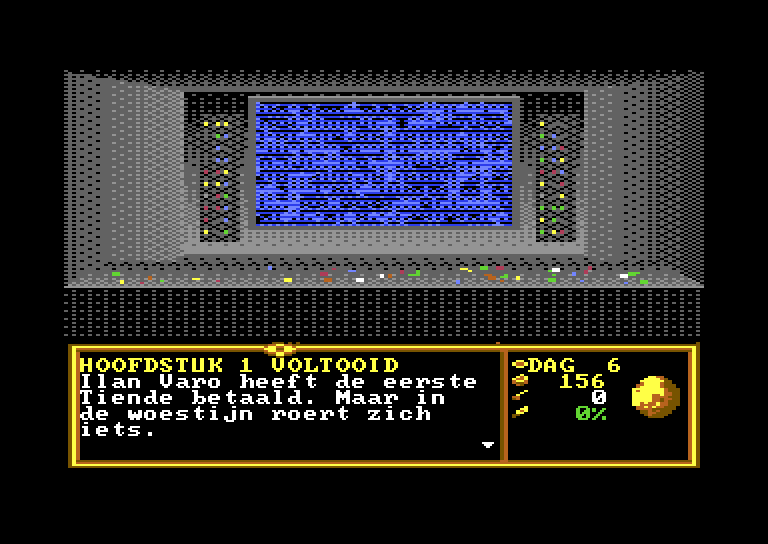

# ASHKARA – The Amber Desert (Commodore 64)

An adventure/strategy game for the **Commodore 64**, inspired by the structure of Cryo's *Dune* (1992), set in an original world. Written in C and 6502 assembly with **cc65**, running on a real C64 or in **VICE**.

<p align="center">
  
  
</p>
<p align="center">
  
  
</p>
<p align="center">
  
  
</p>

> The in-game text is in Dutch. The world, characters and art are original. Only the *game structure* of Cryo's Dune serves as a reference.

## The story

You are **Ilan Varo**, the new governor of **Ashkara**, a desert planet. Under the sand lies **amberite**, glowing crystals that power the jump drives of the Ring of Worlds. Governor **Kasimir Vorr**'s Mining Consortium still pulls the strings from its northern Citadel, and the High Council demands a regular **Tithe** of amber. Win the trust of the nomadic **Kethari**, put their camps to work harvesting amber, and pay the Tithe on time. Later, after Vorr's betrayal, free the planet by force of arms or by bringing back the water.

## Features

- **Split-screen display:** a multicolor bitmap scene (160×136) above a multicolor text panel, switched by a raster interrupt, with a rotating globe sprite.
- **Talking characters:** large portraits patched over the scene, with lip-synced mouth animation and typewriter text.
- **Story script VM:** dialogue, menus and the story flow live in script files (`script/*.ash`). A Python compiler turns them into compressed bytecode, and a small VM runs it on the C64.
- **Strategy layer:**
  - a map with location markers and a blinking destination;
  - travel that costs days, with Kethari camps discovered along the way;
  - recruiting camps (trust, gifts, Tarik's blessing) and giving them jobs (harvest or train);
  - a daily simulation and the Tithe deadline, with one warning before game over;
  - from chapter 2 on, Consortium raids on harvesting camps, unless a training camp guards them.
- **Save and load** to disk (`ASHKARA.SAV`), from any menu with F7.
- **Everything on one 1541 disk:** scenes and portraits are deflate-compressed and unpacked under the Kernal ROM.

## Status

| Phase | Content | State |
|---|---|---|
| 0 | Screens, file formats, raster split, loader, character patches, screen demo | ✅ |
| 1 | Engine core: input, menus, text paging, script VM, script compiler | ✅ |
| 2 | **Chapter 1 playable**: map, travel, discovery, recruiting, harvesting, the first Tithe, game over | ✅ |
| 3 | Consortium raids, save/load | ✅ |
| 4 | Chapters 2–5, battles, terraforming, two endings | ⏳ |
| 5 | SID music, fastloader, real-hardware testing | ⏳ |

## Play

Download `ashkara.d64` from the [latest release](https://github.com/mfidder2026/dune64/releases/latest) and start it in VICE:

```bash
x64sc -autostart ashkara.d64
```

On a real C64 or a C64 Ultimate, mount the D64 and `LOAD"*",8,1` / `RUN`. A fastload cartridge (or JiffyDOS) is recommended until the fastloader lands in phase 5.

**Controls:** joystick in port 2 or the cursor keys to choose, and fire, Return or Space to confirm or turn the page. On the map, left/right pages through the destinations. **K** opens the map, and **F7** opens the save/load menu. You can also load a saved game from the start menu after the title screen.

**Tips:** one camp alone can't harvest 500 amber in time, so explore and recruit a second camp. After the first Tithe, the Consortium starts raiding harvesting camps; a camp that trains (STRIJD) protects every camp within 6 cells.

## Build

Requirements: Python 3.9+ with Pillow and NumPy, [cc65](https://cc65.github.io/) 2.19 and [VICE](https://vice-emu.sourceforge.io/) (x64sc, c1541).

```bash
pip install pillow numpy
python build.py            # assets + screen demo + game (D64 images)
python build.py game       # compile scripts + game -> build/ashkara.d64
python build.py play       # build the game and start it in VICE
python build.py run        # build and start the screen demo
python build.py test       # headless VICE tests: screenshots in build/test/
```

`build.py` finds cc65 and VICE in `PATH`, `./tools`, `../tools` or `../c64`. You can also point at them with `CL65=…`, `C1541=…` and `X64SC=…`.

## Project layout

```
src/        engine: raster split (irq.s), graphics, UI, text, script VM, map, simulation
script/     story scripts (*.ash) and ids.txt (names -> ids)
data/       locations.json: map locations, camps and their starting values
pipeline/   Python tools: art generation, C64 converters, script compiler, data compiler
assets/     C64 files that go on the disk (.scn scenes, .pat portraits, .scr scripts, charset, sprites)
art/        source art (indexed PNG, Koala files)
mockups/    full-screen mockups and the storyboard
demo/       frozen phase-0 screen demo (ashkara-demo.d64)
docs/       README screenshots
DESIGN.md   the full design document (Dutch): systems, memory map, formats, VM, phases
```

The complete storyboard is in [`mockups/STORYBOARD.png`](mockups/STORYBOARD.png). The design document [`DESIGN.md`](DESIGN.md) covers the memory map, the VIC-II setup, the file formats, the bytecode and the acceptance criteria per phase.

## Credits

- Design, code and art: [mfidder2026](https://github.com/mfidder2026), with Claude (Anthropic).
- Font: *font8x8* (public domain), see `pipeline/third_party/`.
- Reference for the game structure: *Dune* by Cryo Interactive (1992). No names, characters or art from Dune are used.
