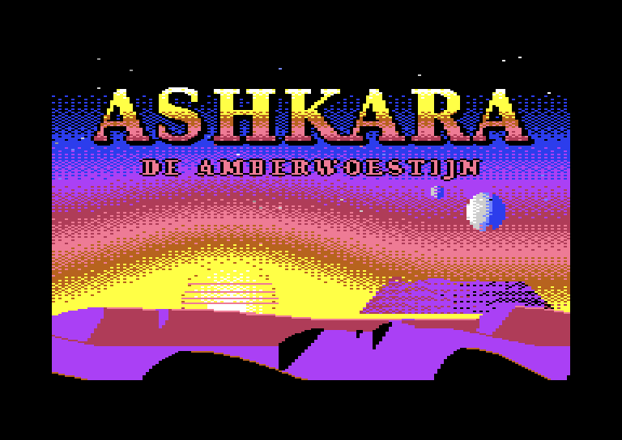
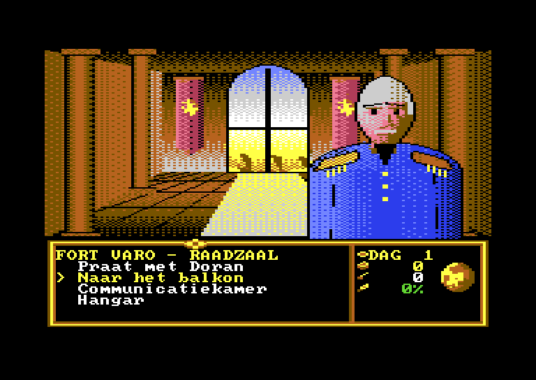
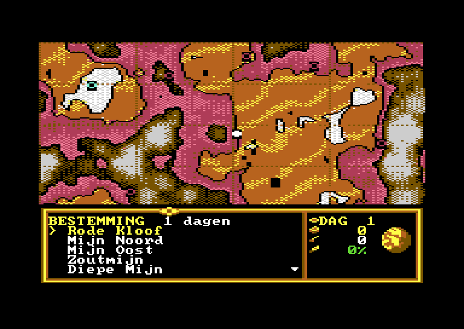
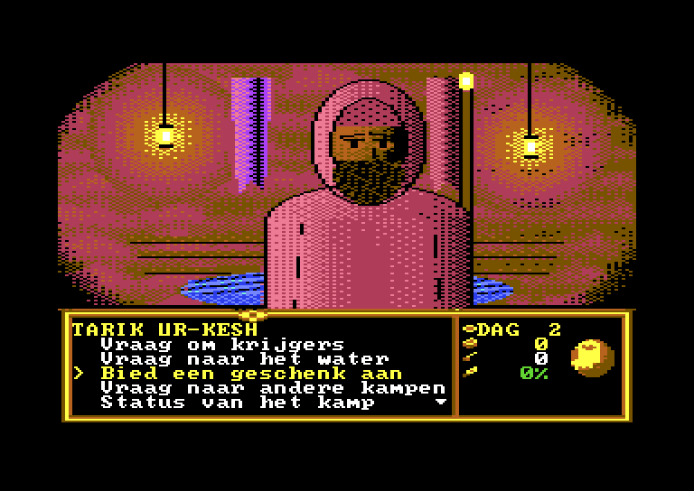
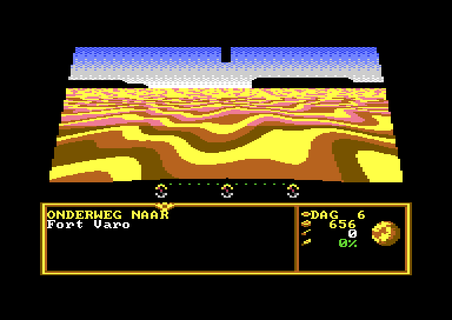
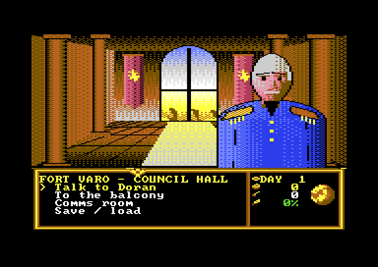
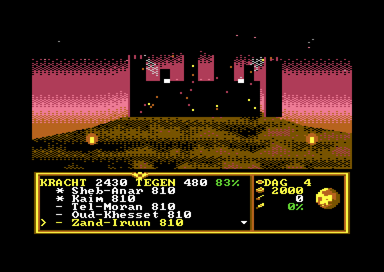
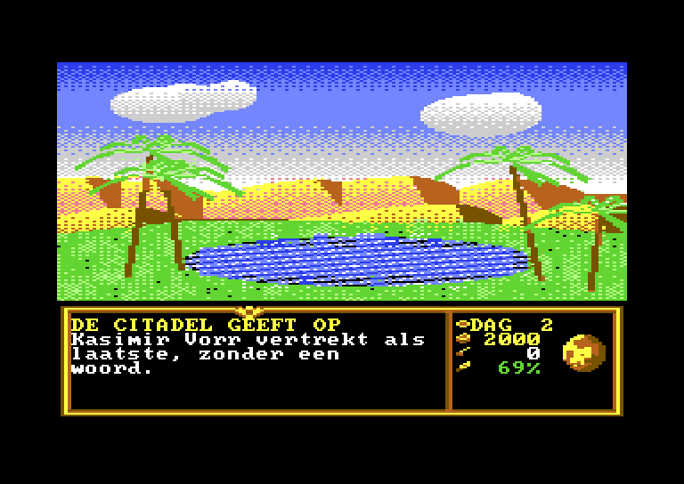
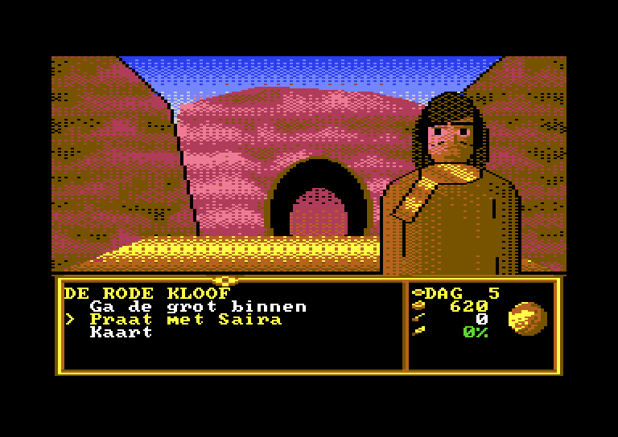
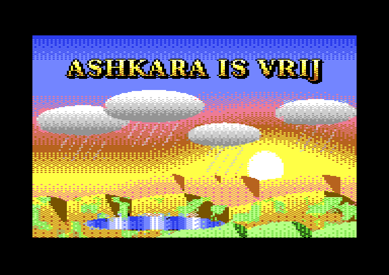

# ASHKARA – The Amber Desert (Commodore 64)

An adventure/strategy game for the **Commodore 64**, inspired by the structure of Cryo's *Dune* (1992), set in an original world. Written in C and 6502 assembly with **cc65**, running on a real C64 or in **VICE**.

<p align="center">
  
  
</p>
<p align="center">
  
  
</p>
<p align="center">
  
  
</p>
<p align="center">
  
  
</p>
<p align="center">
  
  
</p>

> The game is fully playable in **English or Dutch**: choose after the title screen, or switch at any time with F7. The world, characters and art are original. Only the *game structure* of Cryo's Dune serves as a reference.

## The story

You are **Ilan Varo**, the new governor of **Ashkara**, a desert planet. Under the sand lies **amberite**, glowing crystals that power the jump drives of the Ring of Worlds. Governor **Kasimir Vorr**'s Mining Consortium still pulls the strings from its northern Citadel, and the High Council demands a regular **Tithe** of amber. Win the trust of the nomadic **Kethari**, put their camps to work harvesting amber, and pay the Tithe on time. Later, after Vorr's betrayal, free the planet by force of arms or by bringing back the water.

## Features

- **Split-screen display:** a multicolor bitmap scene (160×136) above a multicolor text panel, switched by a raster interrupt, with a rotating globe sprite.
- **Flying over the desert:** like the ornithopter flights in the original, every journey shows a cockpit view with dunes rushing toward you. It runs at full frame rate on the C64 thanks to color cycling, without redrawing the bitmap. Night falls during long flights.
- **English and Dutch:** every script line exists in both languages, and both languages compile to identical bytecode with only different strings. That lets you switch language mid-game.
- **Talking characters:** large portraits patched over the scene, with lip-synced mouth animation and typewriter text.
- **Story script VM:** dialogue, menus and the story flow live in script files (`script/*.ash`). A Python compiler turns them into compressed bytecode, and a small VM runs it on the C64.
- **Strategy layer:**
  - a map with location markers and a blinking destination;
  - travel that costs days, with Kethari camps discovered along the way;
  - recruiting camps (trust, gifts, Tarik's blessing) and giving them jobs (harvest or train);
  - a daily simulation and the Tithe deadline, with one warning before game over;
  - from chapter 2 on, Consortium raids on harvesting camps, unless a training camp guards them.
- **The whole story:** five chapters, from your arrival through the Consortium's betrayal to the battle for the Citadel. There are **two endings**: conquer the Citadel with your Kethari warriors, or turn the desert green with windcatchers until the Consortium gives up.
- **Battles:** pick up to three camps (and decide whether Ilan risks joining). Each camp's strength comes from its size, training and weapons from the traders of Mer, and you see your chance of victory before you attack.
- **Balance-tested:** a Python port of the simulation plays both strategies 300 times. The military route wins in 92% of runs (median day 59), the green route in 74% (median day 88).
- **Original SID music:** "Amberwind", in D harmonic minor, with bass, arpeggio and lead. The player runs in the raster interrupt; switch it on or off with F7.
- **Own fastloader:** a 2-bit loader whose timing is driven by the C64, so it also works with the screen on, sprites and interrupts, on PAL and NTSC. Scenes load in under 3 seconds, more than twice as fast as the Kernal. It automatically falls back to the Kernal if the drive isn't a 1541 (SD2IEC, etc.).
- **Save and load** to disk (`ASHKARA.SAV`), from any menu with F7.
- **Everything on one 1541 disk:** scenes and portraits are deflate-compressed and unpacked under the Kernal ROM.

## Status

| Phase | Content | State |
|---|---|---|
| 0 | Screens, file formats, raster split, loader, character patches, screen demo | ✅ |
| 1 | Engine core: input, menus, text paging, script VM, script compiler | ✅ |
| 2 | **Chapter 1 playable**: map, travel, discovery, recruiting, harvesting, the first Tithe, game over | ✅ |
| 3 | Consortium raids, save/load | ✅ |
| 4 | Chapters 2–5, battles, terraforming, two endings | ✅ |
| 5 | SID music, fastloader, real-hardware preparation | ✅ (tested in VICE with true drive emulation; real-hardware test still open) |

## Play

Download the game's `.d64` from the [latest release](https://github.com/mfidder2026/dune64/releases/latest) and start it in VICE:

```bash
x64sc -autostart ashkara.d64
```

On a real C64 or a C64 Ultimate, mount the D64 and `LOAD"*",8,1` / `RUN`. The main program loads through the Kernal (~16 KB, compressed); after that the game installs its own fastloader on a 1541. Keep only drive 8 switched on while playing (the fastloader uses the ATN line).

### Real hardware
The game has been tested in VICE with cycle-exact 1541 emulation (true drive emulation), on PAL and NTSC, but not yet on a real machine. To check your setup, use the diagnostic disk from the release (or `python build.py fltest`). `fltest.d64` loads a few files via the Kernal and via the fastloader and compares length, checksum and load time; it should report "5 van 5 goed".

**Controls:** joystick in port 2 or the cursor keys to choose, and fire, Return or Space to confirm or turn the page. On the map, left/right pages through the destinations. **K** opens the map, and **F7** opens the save/load/language menu. You can also load a saved game from the start menu after the title screen.

**Tips:** one camp alone can't harvest 500 amber in time, so explore and recruit a second camp. After the first Tithe, the Consortium starts raiding harvesting camps; a camp that trains (STRIJD) protects every camp within 6 cells.

## Build

Requirements: Python 3.9+ with Pillow and NumPy, [cc65](https://cc65.github.io/) 2.19 and [VICE](https://vice-emu.sourceforge.io/) (x64sc, c1541).

```bash
pip install pillow numpy
python build.py            # assets + screen demo + game (D64 images)
python build.py game       # compile scripts + game -> build/ashkara.d64
python build.py play       # build the game and start it in VICE
python build.py run        # build and start the screen demo
python build.py test       # headless VICE tests: screenshots in build/test/
python build.py fltest     # fastloader diagnostic disk: build/fltest.d64
python build.py tde        # the game with and without fastloader under true drive emulation
```

`build.py` finds cc65, VICE and (optionally) exomizer in `PATH`, `./tools`, `../tools` or `../c64`. You can also point at them with `CL65=…`, `C1541=…` and `X64SC=…`.

## Project layout

```
src/        engine: raster split (irq.s), graphics, UI, text, script VM, map, simulation
script/     story scripts (*.ash) and ids.txt (names -> ids)
data/       locations.json: map locations, camps and their starting values
pipeline/   Python tools: art generation, C64 converters, script compiler, data compiler
assets/     C64 files that go on the disk (.scn scenes, .pat portraits, .scr scripts, charset, sprites)
art/        source art (indexed PNG, Koala files)
mockups/    full-screen mockups and the storyboard
demo/       frozen phase-0 screen demo (ashkara-demo.d64)
docs/       README screenshots
DESIGN.md   the full design document (Dutch): systems, memory map, formats, VM, phases
```

The complete storyboard is in [`mockups/STORYBOARD.png`](mockups/STORYBOARD.png). The design document [`DESIGN.md`](DESIGN.md) covers the memory map, the VIC-II setup, the file formats, the bytecode and the acceptance criteria per phase.

## Credits

- Design, code and art: [mfidder2026](https://github.com/mfidder2026), with Claude (Anthropic).
- Font: *font8x8* (public domain), see `pipeline/third_party/`.
- Reference for the game structure: *Dune* by Cryo Interactive (1992). No names, characters or art from Dune are used.
